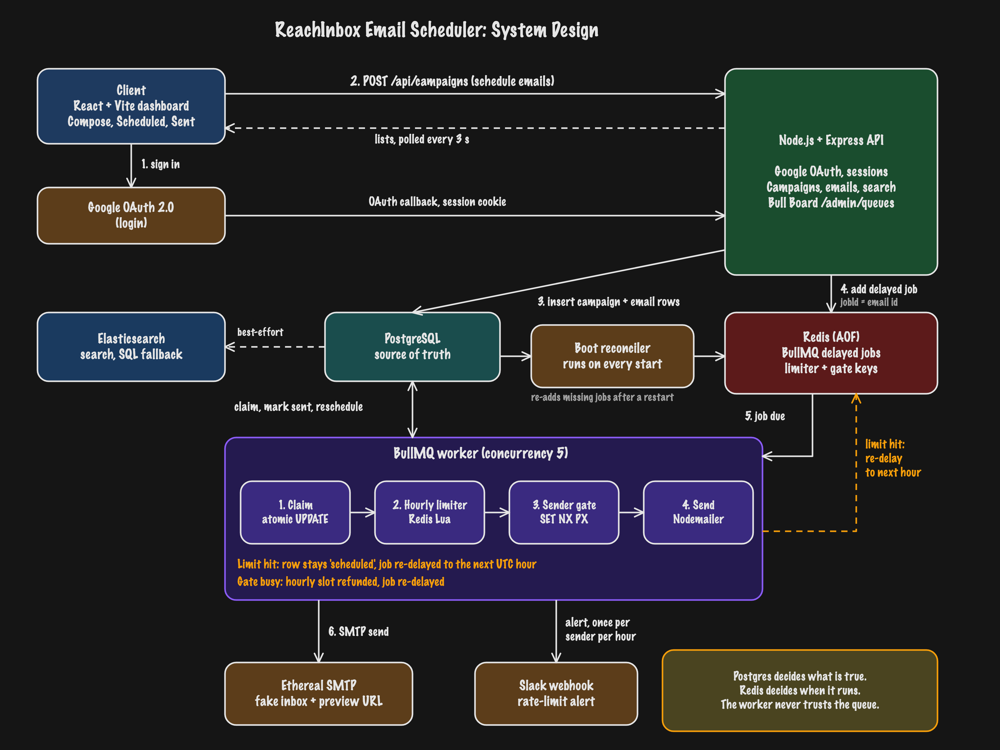

# ReachInbox Email Job Scheduler

An email scheduler: a React dashboard and an Express API that schedule bulk emails for a future time, send them through a
BullMQ worker with per-sender hourly limits, and survive restarts without losing or duplicating an email. There is no cron and
no `setInterval`: every delay is a BullMQ delayed job.

- **Backend:** TypeScript, Express, BullMQ, Redis (AOF), PostgreSQL, Nodemailer + Ethereal, Elasticsearch (optional)
- **Frontend:** React 18, Vite, Tailwind, TipTap, TanStack Query
- **Auth and alerts:** Google OAuth login, Slack OAuth rate-limit alerts

## Contents

1. [How to run](#how-to-run)
2. [Ethereal Email and environment variables](#ethereal-email-and-environment-variables)
3. [Architecture overview](#architecture-overview)
4. [How scheduling works](#how-scheduling-works)
5. [Persistence on restart, and no duplicates](#persistence-on-restart-and-no-duplicates)
6. [Rate limiting and concurrency](#rate-limiting-and-concurrency)
7. [Features implemented](#features-implemented)
8. [Tests and load test](#tests-and-load-test)
9. [Assumptions and trade-offs](#assumptions-and-trade-offs)

## How to run

Prerequisites: Node 20+ and Docker.

### Backend (Express API, Redis, PostgreSQL, BullMQ worker)

```bash
cp .env.example .env                  # then fill in JWT_SECRET and the Google credentials (see the next section)
docker compose up -d                  # PostgreSQL (5432), Redis with AOF (host port 6380), Elasticsearch (9200)

cd backend
npm install
npm run migrate                       # creates the tables
npm run dev                           # Express API + BullMQ worker in one process (:4000)
```

- Redis is published on host port **6380** so it does not collide with a Redis already running on 6379.
- To run the worker as a separate process: set `RUN_WORKER_IN_API=false`, then `npm run build && npm start` for the API and
  `npm run start:worker` for the worker.
- Elasticsearch is optional. Leave `ELASTICSEARCH_URL` empty and search falls back to SQL.
- Health check: `curl localhost:4000/health`.

### Frontend

```bash
cd frontend
npm install
cp .env.example .env                  # VITE_API_URL=http://localhost:4000
npm run dev                           # http://localhost:5173
```

Login uses Google OAuth, so add Google credentials first. A full walkthrough is in [Google and Slack setup](#google-and-slack-setup)
below.

## Ethereal Email and environment variables

**Ethereal** (ethereal.email) is a fake SMTP service from the Nodemailer authors. Nothing reaches a real inbox, and every sent
message has a preview page. There is nothing to sign up for or configure by hand:

1. The first time a user logs in, the backend calls `nodemailer.createTestAccount()` to create `DEFAULT_SENDER_COUNT` (3) Ethereal
   accounts and stores their SMTP credentials in the `senders` table.
2. A campaign rotates across those senders, or uses one chosen in the **From** field. More senders can be added in the UI.
3. After each send the worker stores the Ethereal preview URL, and the email's detail page links to it.

All configuration comes from environment variables in the root `.env`, validated at startup (a bad value exits with a readable
list). `.env.example` has working defaults for everything except the secrets.

| Variable | Default | Purpose |
|---|---|---|
| `BACKEND_URL` | `http://localhost:4000` | Public URL of the API. OAuth redirect URIs are built from it. |
| `FRONTEND_URL` | `http://localhost:5173` | Where users land after login, and the CORS origin. |
| `JWT_SECRET` | (required, 32+ chars) | Signs session cookies and OAuth state. |
| `DATABASE_URL`, `REDIS_URL` | see `.env.example` | Postgres and Redis. |
| `ELASTICSEARCH_URL` | `http://127.0.0.1:9200` | Leave empty to run without Elasticsearch (search falls back to SQL). |
| `GOOGLE_CLIENT_ID`, `GOOGLE_CLIENT_SECRET` | empty | Google OAuth web client. |
| `SLACK_CLIENT_ID`, `SLACK_CLIENT_SECRET` | empty | Slack app credentials. |
| `WORKER_CONCURRENCY` | 5 | Parallel jobs per worker. |
| `MIN_DELAY_BETWEEN_EMAILS_MS` | 2000 | Minimum gap between two sends of the same sender. |
| `MAX_EMAILS_PER_HOUR_PER_SENDER` | 200 | Hard ceiling for any campaign's hourly limit. |
| `EMAIL_JOB_ATTEMPTS`, `EMAIL_JOB_BACKOFF_MS` | 3, 5000 | Retry policy. |
| `STALE_PROCESSING_MS` | 120000 | When a `processing` claim is considered abandoned. |
| `MAX_RECIPIENTS_PER_CAMPAIGN` | 5000 | Upper bound per campaign. |
| `RUN_WORKER_IN_API` | `true` | Run the worker inside the API process. |
| `DEFAULT_SENDER_COUNT` | 3 | Ethereal senders created per new user. |

### Google and Slack setup

Login needs a Google OAuth client. Slack is optional: it only powers the rate-limit alert message.

Slack refuses plain-HTTP redirect URLs, and the session cookie belongs to one host, so for local development expose the app
through a tunnel and use **one public HTTPS URL for both the app and the API**:

```bash
ngrok http 5173            # or: cloudflared tunnel --url http://localhost:5173
```

Set `BACKEND_URL=https://<tunnel>` and `FRONTEND_URL=https://<tunnel>` in the root `.env`, leave `VITE_API_URL=` empty in
`frontend/.env`, and restart both servers (Vite proxies `/api` and `/admin` to the backend). If you only need Google login
on `localhost`, skip the tunnel and keep the default URLs.

**Google.** In the [Google Cloud console](https://console.cloud.google.com/auth/clients) create a project, configure the consent
screen (External, *Testing*, add your account under **Test users**), then create an OAuth client of type **Web application** with
the redirect URI `https://<tunnel>/api/auth/google/callback` (or `http://localhost:4000/api/auth/google/callback`). Put the client ID
and secret in `.env` as `GOOGLE_CLIENT_ID` and `GOOGLE_CLIENT_SECRET`.

**Slack (optional).** At <https://api.slack.com/apps> choose **Create an App > From a manifest**, paste this JSON (replace
`<tunnel>`), then copy the client ID and secret from **Basic Information** into `SLACK_CLIENT_ID` and `SLACK_CLIENT_SECRET`. In the
app, open the user menu, click **Connect Slack** and choose a channel.

```json
{
  "display_information": { "name": "ReachInbox Alerts" },
  "features": { "bot_user": { "display_name": "ReachInbox Alerts", "always_online": false } },
  "oauth_config": {
    "redirect_urls": ["https://<tunnel>/api/slack/callback"],
    "scopes": { "bot": ["incoming-webhook"] }
  },
  "settings": { "org_deploy_enabled": false, "socket_mode_enabled": false, "token_rotation_enabled": false }
}
```

## Architecture overview



The diagram is also available as an editable Excalidraw file: [docs/system-design.excalidraw](docs/system-design.excalidraw).

Responsibilities are split on purpose:

- **PostgreSQL decides what is true.** Every email has a status (`scheduled`, `processing`, `sent`, `failed`), a
  `scheduled_at`, attempts, and the Ethereal preview URL.
- **Redis decides when it runs.** BullMQ holds the delayed jobs. Losing Redis loses timing, never data, because the boot
  reconciler rebuilds the queue from Postgres.
- **The worker never trusts the queue.** A job is only a hint that an email is due. The worker re-reads the row and claims it
  atomically before doing anything.

## How scheduling works

1. `POST /api/campaigns` validates the body (zod), sanitizes the HTML with `sanitize-html`, and in one Postgres
   transaction inserts the campaign and one row per recipient. Recipient `i` is due at
   `startTime + i * delayBetweenMs`, and senders are assigned round-robin.
2. After the commit, each email is added to BullMQ with `delay = scheduled_at - now` and `jobId = email.id`.
3. When a job becomes due the worker, in order:
   1. **Claims** the row (`scheduled` to `processing`) with a single conditional `UPDATE`. If it matches no row
      (already sent, cancelled, or claimed by another worker) the job exits quietly.
   2. Consumes one slot from the **hourly limiter**. If the sender's limit is reached the email is rescheduled
      (see below).
   3. Checks the **per-sender gate** (`SET key NX PX minDelay`). If the sender sent too recently, the hourly slot is
      refunded, the row is released back to `scheduled`, and the job is moved back to delayed with `moveToDelayed`
      and `DelayedError`. The worker never sleeps and holds no concurrency slot while waiting.
   4. Sends through Nodemailer (HTML plus text alternative plus attachments), then marks the row `sent` and stores
      the Ethereal preview URL.
4. A failing send is retried by BullMQ with exponential backoff (`EMAIL_JOB_ATTEMPTS`, `EMAIL_JOB_BACKOFF_MS`); after the
   last attempt the row becomes `failed` with the error text.

A user can cancel a scheduled email from its detail page. Cancel is an atomic `DELETE ... WHERE status='scheduled'`, so
it can never race with a send: exactly one of "cancelled" and "claimed" wins (covered by a test that races them).

## Persistence on restart, and no duplicates

| Failure | What happens |
|---|---|
| API or worker killed (`kill -9`) while emails are delayed | Delayed jobs live in Redis (AOF, `appendfsync everysec`). On boot the process resumes and sends them on time. |
| Killed in the middle of a send | The row is left `processing`. After `STALE_PROCESSING_MS` another worker takes the claim over; until then the job is deferred, not dropped. |
| Redis data lost | The boot reconciler (`scheduler/reconcile.ts`) finds `scheduled` rows with no job and re-enqueues them, and resets stale `processing` claims. |
| Same job delivered twice | The claim `UPDATE ... RETURNING` lets exactly one caller proceed. Tested with 25 parallel claims. |
| Same email enqueued twice | `jobId = email id` makes the second `add` a no-op. |

Recovery was exercised for real, not only in unit tests: `kill -9` with 20 emails pending, a Redis wipe, and a
1000-email load test, each ending with SQL counts that add up (nothing lost, nothing sent twice).

The one honest edge: if the process dies after SMTP accepted a message but before the row is marked `sent`, the claim
eventually goes stale and the email is sent again. Exactly-once delivery across an SMTP server and a database is not
possible without the provider's cooperation; this design chooses at-least-once with a very small window over losing mail.

## Rate limiting and concurrency

- **Window.** The hourly window is `floor(epochMs / 3_600_000)` in UTC, so every process agrees on it without coordination.
- **Limiter.** A Lua script (`INCR` plus `EXPIRE`, and `DECR` when the limit is exceeded) runs atomically in Redis, so
  concurrent workers cannot overshoot the limit. The effective limit is `min(campaign hourly limit, MAX_EMAILS_PER_HOUR_PER_SENDER)`.
- **When the limit is hit.** The email is not failed and not slept on. Its `scheduled_at` moves to the start of the
  next window (or later, ranked by position among the same campaign and sender so order is preserved and a later
  window is not overfilled), the job is re-delayed, and the row stays `scheduled`.
- **Spacing.** The campaign's "Delay between 2 emails" sets each email's `scheduled_at` (`startTime + i * delay`).
  On top of that, a per-sender gate enforces `MIN_DELAY_BETWEEN_EMAILS_MS` between two sends of the same sender,
  across all workers. A gate deferral refunds the hourly slot, so it never burns the limit. Different senders are
  independent, so throughput scales with the number of senders.
- **Concurrency.** `WORKER_CONCURRENCY` jobs run in parallel in one worker; you can also run several worker processes,
  because every shared decision (claim, gate, limiter) is atomic in Postgres or Redis.
- **Slack alert.** When a sender is limited, one message is posted per sender per hour window (deduped in Redis with
  `slack-notified:{sender}:{window}`). It is only claimed if the user has Slack connected, so connecting mid-window
  still gets the next alert.

## Features implemented

### Backend

| Area | What is implemented |
|---|---|
| Scheduler | `POST /api/campaigns` creates one `emails` row and one BullMQ delayed job per recipient (`jobId` = email id). No cron. Cancel a scheduled email atomically. See [How scheduling works](#how-scheduling-works). |
| Persistence | PostgreSQL as the source of truth, Redis with AOF, a boot reconciler and atomic claims. See [Persistence on restart](#persistence-on-restart-and-no-duplicates). |
| Rate limiting | Hourly limit per sender (atomic Redis Lua script), a per-campaign limit capped by `MAX_EMAILS_PER_HOUR_PER_SENDER`, and a minimum delay between two sends. Excess emails are rescheduled to the next hour, not dropped. |
| Concurrency | `WORKER_CONCURRENCY` parallel jobs per worker, and any number of worker processes. |
| Retries | Exponential backoff (`EMAIL_JOB_ATTEMPTS`, `EMAIL_JOB_BACKOFF_MS`), then the row becomes `failed` with the error. |
| Senders | Ethereal accounts per user, rotated per campaign or chosen explicitly. |
| Auth | Google OAuth 2.0 authorization-code flow, httpOnly JWT session cookie. Every `/api` route except login requires it. |
| Alerts | Slack OAuth (`incoming-webhook`): one message per sender per hour window when a sender hits its limit. |
| Search and queue | Elasticsearch search with an automatic SQL fallback, Bull Board at `/admin/queues` (login required), `GET /api/queue/counts`. |

### Frontend

| Screen | What is implemented |
|---|---|
| Login | "Continue with Google". Unauthenticated users are redirected here. |
| Dashboard | **Scheduled** and **Sent** tables with live counts, status chips and the exact send time, refreshed every 3 seconds. Search bar and filters (status, sender). |
| Compose | Recipients pasted or imported from a CSV, subject, rich-text body (TipTap), up to 3 attachments, sender picker, **Delay between 2 emails**, **Hourly Limit**, and **Send Later** with a date and time picker. |
| Email detail | Full content, attachments, status, and a link to the Ethereal preview. A scheduled email can be cancelled here. |

## Tests and load test

```bash
cd backend  && npm test       # 108 tests, need the docker services up
cd frontend && npm test       # 28 tests
```

`npm run load-test` (API and worker running) schedules 1000 emails with a limit of 5 per hour per sender and writes
`docs/load-test-output.txt`. In the committed run: 15 sent in the first window (3 senders x 5), 985 rescheduled across later
windows, 0 lost, 0 failed, one Slack alert per sender.

## Assumptions and trade-offs

- **Ethereal, not real SMTP.** Each user gets Ethereal test accounts, so no email leaves the sandbox. Swapping in a real SMTP
  provider only changes the sender rows (`smtp_host`, `smtp_user`, `smtp_pass`).
- **Sender credentials in Postgres.** Ethereal passwords are stored in plain text because they are throwaway test credentials;
  a real provider would need encryption at rest or a secrets manager.
- **At-least-once, not exactly-once.** See the edge case under persistence. A claim plus an idempotent job id removes every
  duplicate except a crash between "SMTP accepted" and "row marked sent".
- **Rate-limited emails are rescheduled, not failed.** The planned next-window schedule can briefly plan more than the limit into
  one window when slots already passed (visible as a `(*)` row in the load test output); the Redis limiter is what enforces
  the cap at send time and pushes any excess further out, so actual sends never exceed it.
- **Hourly windows are UTC clock hours**, not rolling 60 minute windows. Simpler and coordination-free, at the cost of allowing a
  burst across a window boundary.
- **Polling, not websockets.** The dashboard polls every 3 seconds; it is simple and good enough at this scale.
- **Elasticsearch is best-effort.** Postgres stays the source of truth, and ES results are hydrated from it. Search degrades to
  SQL `ILIKE` rather than failing.
- **One user, one workspace.** Emails, senders and Slack connections are scoped to the logged-in user; there are no teams or roles.
- **No features beyond the brief.** There is no signup/password login, unsubscribe handling, bounce processing or templates.
- **Attachments live in Postgres** (`bytea`, max 3 files, 2MB each, 5MB total) behind a small in-process LRU cache. Fine for the
  limits; object storage would replace it for larger files.
